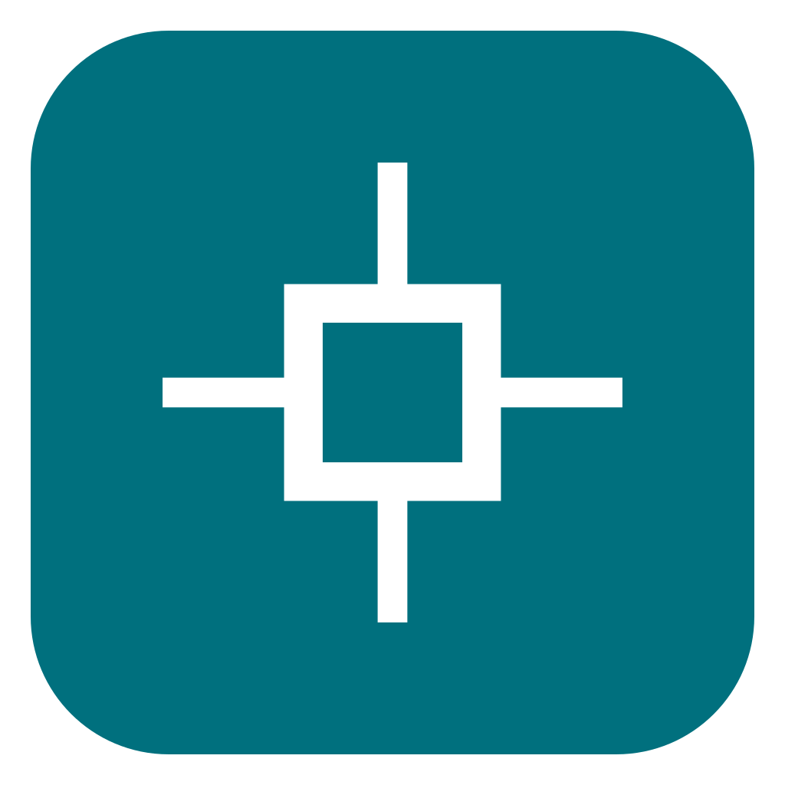
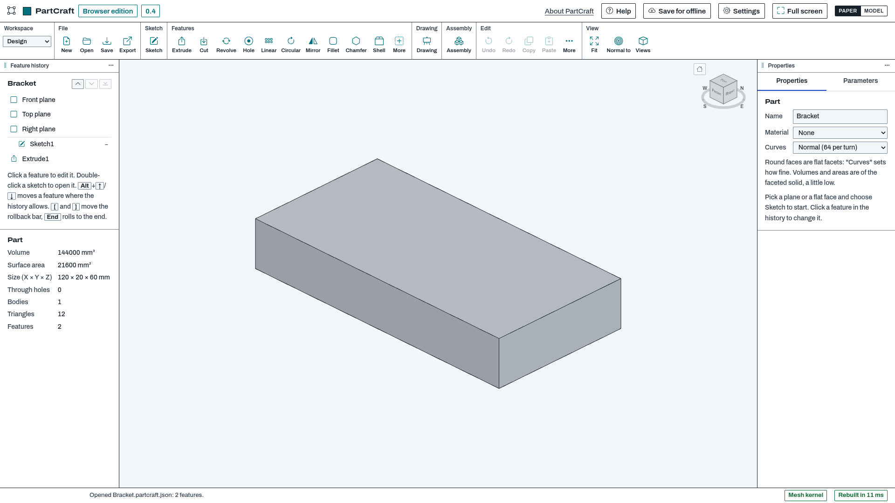

# PartCraft

Sketch, constrain, extrude. Then build the assembly.

**[Website](https://getcadcraft.com/apps/partcraft) | [Try it in your browser](https://getcadcraft.com/try/partcraft) | [Download](https://getcadcraft.com/download/partcraft) | [Help and tutorials](https://getcadcraft.com/tutorials/partcraft) | [News](https://getcadcraft.com/news) | [Suggest a feature](https://getcadcraft.com/suggest)**

[](https://getcadcraft.com/try/partcraft)

<sub>Paper space above; [the same in model space](screenshots/model.png). Both are the 0.4 browser edition.</sub>

PartCraft is the parametric parts & assemblies app in the [CadCraft](https://getcadcraft.com) family: Constrained sketches, feature history, assemblies with joints and drawings with GD&T. STEP in and out.

## Use it

Try it now at https://getcadcraft.com/try/partcraft, or get it for your platform. Your files stay on your computer either way.

| Platform | Status |
|---|---|
| [Browser](web/) | 0.4: `partcraft-browser-edition-v0.4.0.zip` in [Releases](https://github.com/getcadcraft/partcraft/releases), or [`web/v0.4/`](web/v0.4/) from a clone |
| [Windows](windows/) | 0.4: installer in [Releases](https://github.com/getcadcraft/partcraft/releases) (not code-signed yet) |
| [Linux](linux/) | 0.4: `.deb` and AppImage in [Releases](https://github.com/getcadcraft/partcraft/releases); Flathub manifest in [`linux/flathub/`](linux/flathub/) |
| [macOS](macos/) | Coming in 0.5 |
| [iPad](ios/) | Planned |
| [Android](android/) | Planned |

## Work on it

```sh
node devshell/serve.mjs     # Node 20.19 or newer, no packages; then open http://127.0.0.1:8000/
npm test                    # the app's tests; libraries are fetched by exact version
```

`app/` is the 0.4 build (the same code on every platform), `web/` `windows/` `linux/` `macos/` `ios/` `android/` hold what ships or builds it on each, `devshell/` runs it without the website (`devshell/README.md`), `tests/` and `fixtures/` are its tests and public sample files. How to contribute: [CONTRIBUTING.md](CONTRIBUTING.md); building from source: [BUILDING.md](BUILDING.md).

## License

Apache License 2.0 ([LICENSE](LICENSE), [NOTICE](NOTICE)). Libraries and their licenses: [THIRD_PARTY.md](THIRD_PARTY.md). **One exception:** Python scripts run on Pyodide (MPL-2.0; CPython under the PSF License), shipped unmodified in its own folder `assets/vendor/pyodide/<version>/` (owner decision, 2026-10-13); its license texts are in THIRD_PARTY.md. Everything else is Apache-2.0 or permissive. Where the code comes from: [PROVENANCE.md](PROVENANCE.md). The names are trademarks; a fork must rename: [TRADEMARKS.md](TRADEMARKS.md).
